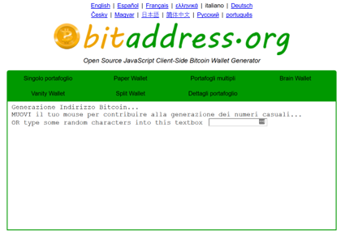
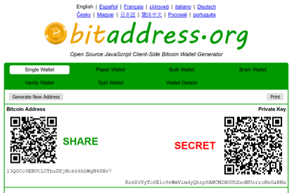

# Laboratory 1 Tutorial

## Generate Bitcoin Private key

As a first step in this laboratory, we need to randomly generate a
Bitcoin private key. For this step we use the website
[bitaddress.org](https://www.bitaddress.org). Bitaddress.org is an open-source
project that provides a client-side Bitcoin Wallet Generator. This
website uses the source of randomness generated by the movement of the
mouse to create a truly random private key.

To generate the private key on [bitaddress.org](https://www.bitaddress.org),
we move the mouse around a bit until we will get a new address/private
key combination.

The private key is the alphanumerical string in the bottom-right of the
box, in this example:

`Kx6XvUyToSE1o9eWmVimdyQhrp8ANCM2HGUhXxdNUsrroNnGaRNa`

Every key printed in this repository is published, so anybody reading
this page can spend from the address it derives. `README.md`, in the
repository root, is where that is recorded. Generate one of your own and
use that.

## Import private key on Electrum wallet

After generating the private key, we need to import it in a Bitcoin
wallet. For this part of the exercise we use
[Electrum](https://electrum.org/#download) (for Windows we suggest the
portable version). The steps below give the names Electrum 4.8 shows in
English.

On its first launch Electrum opens two windows before the wallet:

- in the "Electrum Terms of Use" window, we click "I Accept";
- in the "Electrum Bitcoin Wallet" window, on the "Network
  Configuration" page, we leave "Use Proxy" and "Select Electrum Server"
  unchecked and click "Next".

The "Create/Restore wallet" window then opens:

1. On the "Electrum wallet" page, we keep the proposed wallet name and
   click "Next".
1. On the "Create new wallet" page, we select "Import Bitcoin addresses
   or private keys" and click "Next".
1. On the "Import Bitcoin Addresses or Private Keys" page, we paste our
   private key and click "Next".
1. On the "Wallet Password" page, we can insert a password to protect
   the new wallet, or leave it empty, and click "Finish".

To see our Bitcoin address we open "View > Addresses", which adds the
"Addresses" tab. The address must be the same as the one previously
shown on bitaddress.org. In this example the Bitcoin address is:

`13QGCc9EBUtLCTbxDXjNok66hhWgN4SHv7`

## Sign a message using Electrum

We are now ready to sign a message using our new Bitcoin wallet. To sign
a message we open "Tools > Sign/verify message". In the "Sign/verify
Message" window we insert the following data:

- in "Message", the message, for example here we will use
  `"My first digital signature"`
- in "Address", the Bitcoin address associated to our private key, in
  this example: `13QGCc9EBUtLCTbxDXjNok66hhWgN4SHv7`

We click "Sign", and Electrum writes the digital signature in
"Signature". In this example it is:
`IEJYASq8amiI+nJ3ppNePTp+b6OPvBcc6WatyM82GmsXdww7Eg7TQAFJ/PPqQwpXEiWIIdm1ItajEGJ7H+Ze8nQ=`

## Verify signed message using Electrum

To verify a digital signature we need:

- the digital signature
- the signed message
- the Bitcoin address associated with the private key used to sign the
  message

To verify a message we open "Tools > Sign/verify message" and we insert
the information in the proposed exercise:

- in "Signature":
  `G+WptuOvPCSswt/Ncm1upO4lPSCWbS2cpKariPmHvxX5eOJwgqmdEExMTKvaR0S3f1TXwggLn/m4CbI2jv0SCuM=`
- in "Message": `Hello, world!`
- in "Address": `1FEz167JCVgBvhJBahpzmrsTNewhiwgWVG`

If we click "Verify", an "Information" window says "Signature verified".

Please note that if we changed even a single character in the message,
the digital signature is no longer valid. For example, if we remove "!"
from the message and click "Verify", an "Error" window says "Wrong
signature".

## Check address transactions on a Block Explorer

The last part of this tutorial is on the Bitcoin Block Explorer. A
Bitcoin Block Explorer is an online blockchain browser which displays the
contents of individual Bitcoin blocks and transactions and the
information about Bitcoin addresses (the transaction history and the
balance).

There are many of different Block Explorer available online, for this
tutorial we will use the one developed by
[Blockstream](https://blockstream.com/) named
[Esplora](https://blockstream.info).

The scope of this exercise is to check the transaction history and the
balance of the Bitcoin address previously used to verify the signature:
`1FEz167JCVgBvhJBahpzmrsTNewhiwgWVG`. To do that we insert the address in
the search bar of the [Block Explorer](https://blockstream.info), the
one reading "Search for block height, hash, transaction, or address",
and press Enter. The "Address" page shows the "Total tx count", the
"Confirmed received" and "Confirmed spent" amounts and the "Confirmed
unspent" balance, and lists the transactions below them.

We can even search the transaction history of the previously created
Bitcoin address, in this example `13QGCc9EBUtLCTbxDXjNok66hhWgN4SHv7`.
Since it is a new address, its "Total tx count" is 0 and its "Confirmed
unspent" balance is 0.
